# Selenium Web Automation Testing

## 1. Giới thiệu

Dự án được thực hiện trong quá trình học tập và thực hành kiểm thử chất lượng phần mềm, với mục tiêu tìm hiểu cách sử dụng **Selenium WebDriver**, **Python** và **pytest** để tự động hóa kiểm thử giao diện website.

Website được lựa chọn để kiểm thử là [Automation Exercise](https://automationexercise.com/), một website thực hành cung cấp các chức năng như xem sản phẩm, tìm kiếm, xem chi tiết sản phẩm, quản lý giỏ hàng, đăng nhập, đăng ký và liên hệ.

Thay vì thực hiện tất cả thao tác kiểm thử thủ công trên trình duyệt, dự án sử dụng các chương trình Python để điều khiển trình duyệt Chrome, thực hiện thao tác trên giao diện và kiểm tra kết quả thông qua các điều kiện xác nhận trong test case.

### 1.1. Mục tiêu

- Làm quen với Selenium WebDriver trong kiểm thử giao diện web.
- Sử dụng Python để viết các test case tự động.
- Sử dụng pytest để tổ chức và thực thi các test case.
- Kiểm tra khả năng hiển thị và hoạt động của các chức năng trên website.
- Sử dụng fixture để khởi tạo và đóng trình duyệt phục vụ quá trình kiểm thử.
- Quản lý mã nguồn và lịch sử thay đổi bằng Git và GitHub.
- Ghi nhận kết quả chạy test để phục vụ việc đánh giá và đối chiếu.

### 1.2. Phạm vi kiểm thử

Dự án hiện có 15 test case, tập trung vào các nhóm chức năng sau:

| Nhóm chức năng | Nội dung kiểm thử |
|---|---|
| Trình duyệt | Kiểm tra khả năng mở website bằng Chrome |
| Đăng nhập và đăng ký | Kiểm tra đăng nhập bằng thông tin không hợp lệ và đăng ký bằng email đã tồn tại |
| Sản phẩm | Kiểm tra trang Products, tìm kiếm sản phẩm và trang chi tiết sản phẩm |
| Giỏ hàng | Kiểm tra thêm sản phẩm và xóa sản phẩm khỏi giỏ hàng |
| Danh mục | Kiểm tra hiển thị danh mục sản phẩm |
| Thương hiệu | Kiểm tra hiển thị thương hiệu và lọc sản phẩm theo thương hiệu |
| Liên hệ | Kiểm tra trang Contact Us và các trường biểu mẫu |
| Login / Signup | Kiểm tra hiển thị biểu mẫu đăng nhập và đăng ký |
| Test Cases | Kiểm tra khả năng mở trang Test Cases |

### 1.3. Website được kiểm thử

- **Tên website:** Automation Exercise
- **URL:** https://automationexercise.com/
- **Trình duyệt:** Google Chrome
- **Phương pháp kiểm thử:** Kiểm thử giao diện web tự động bằng Selenium WebDriver.

## 2. Công nghệ sử dụng

| Công nghệ | Vai trò |
|---|---|
| Python | Ngôn ngữ lập trình viết các test case |
| Selenium WebDriver | Điều khiển trình duyệt và tương tác với các phần tử trên website |
| pytest | Phát hiện, tổ chức và thực thi các test case |
| pytest fixture | Quản lý vòng đời của WebDriver trong mỗi test |
| Google Chrome | Trình duyệt được sử dụng để thực hiện kiểm thử |
| Git | Theo dõi lịch sử thay đổi mã nguồn |
| GitHub | Lưu trữ và quản lý repository trực tuyến |

## 3. Cấu trúc dự án

```text
selenium-tests/
├── .gitignore
├── conftest.py
├── requirements.txt
├── README.md
└── tests/
    ├── test_auth.py
    ├── test_brand_filter.py
    ├── test_brands.py
    ├── test_browser.py
    ├── test_cart.py
    ├── test_cart_remove.py
    ├── test_categories.py
    ├── test_contact.py
    ├── test_login_page.py
    ├── test_products.py
    └── test_test_cases_page.py
```

Thư mục `screenshots/` được sử dụng để lưu các ảnh minh họa trong README. Các file ảnh được quản lý riêng trong repository nếu đã được thêm và commit lên Git.

### 3.1. Giải thích các file và thư mục

#### `.gitignore`

Chứa danh sách các file và thư mục Git không cần theo dõi, chẳng hạn:

- `.venv/`: môi trường Python ảo trên máy cá nhân.
- `__pycache__/`: file cache được Python tạo ra.
- `.pytest_cache/`: dữ liệu cache của pytest.
- `.DS_Store`: file metadata do macOS tạo ra.

Mục đích là giữ repository gọn gàng và tránh đưa các file phát sinh không cần thiết lên GitHub.

#### `requirements.txt`

Liệt kê các thư viện Python cần thiết cho dự án. File này giúp cài đặt lại các dependency trên một môi trường Python khác mà không phải cài từng thư viện riêng lẻ.

#### `conftest.py`

File cấu hình fixture dùng chung cho các test case của pytest.

Fixture `driver` thực hiện các công việc:

1. Khởi tạo Chrome WebDriver.
2. Phóng to cửa sổ trình duyệt.
3. Cung cấp WebDriver cho test case thông qua fixture.
4. Gọi `browser.quit()` sau khi test kết thúc để đóng trình duyệt.

Việc sử dụng fixture giúp tránh phải viết lại đoạn mã khởi tạo và đóng trình duyệt trong từng test case.

#### Thư mục `tests/`

Chứa các file kiểm thử được phân chia theo nhóm chức năng. Mỗi file tập trung vào một phần cụ thể của website để mã nguồn dễ đọc, dễ tìm kiếm và thuận tiện cho việc thực thi test.

## 4. Chi tiết các test case

### 4.1. Kiểm tra trình duyệt

**File:** `tests/test_browser.py`

**Test case:** `test_chrome_opens`

Mục tiêu là kiểm tra khả năng khởi tạo Chrome WebDriver và mở website. Đây là bước kiểm tra cơ bản để xác nhận môi trường Selenium có thể thực hiện thao tác với trình duyệt.

### 4.2. Kiểm tra đăng nhập và đăng ký

**File:** `tests/test_auth.py`

Bao gồm:

- `test_login_with_invalid_credentials`: kiểm tra trường hợp đăng nhập bằng thông tin không hợp lệ.
- `test_signup_with_existing_email`: kiểm tra trường hợp đăng ký bằng email đã tồn tại.

Nhóm test này tập trung vào việc xác nhận website xử lý các trường hợp đầu vào không hợp lệ theo mong đợi của test case.

### 4.3. Kiểm tra sản phẩm

**File:** `tests/test_products.py`

Bao gồm:

- `test_products_page_is_displayed`: kiểm tra trang danh sách sản phẩm.
- `test_search_product_returns_results`: kiểm tra tìm kiếm sản phẩm và kết quả trả về.
- `test_search_product_returns_no_results`: kiểm tra trường hợp tìm kiếm không có kết quả.
- `test_product_details_page_is_displayed`: kiểm tra khả năng mở trang chi tiết sản phẩm.

Nhóm test này giúp kiểm tra các thao tác cơ bản khi người dùng duyệt và tìm kiếm sản phẩm.

### 4.4. Kiểm tra giỏ hàng

**File:** `tests/test_cart.py`

- `test_add_product_to_cart`: kiểm tra thao tác thêm sản phẩm vào giỏ hàng.

**File:** `tests/test_cart_remove.py`

- `test_remove_product_from_cart`: kiểm tra thao tác xóa sản phẩm khỏi giỏ hàng.

Hai file được tách riêng để phân biệt quá trình thêm sản phẩm và quá trình xóa sản phẩm.

### 4.5. Kiểm tra danh mục sản phẩm

**File:** `tests/test_categories.py`

- `test_product_categories_are_displayed`: kiểm tra các danh mục sản phẩm được hiển thị trên trang.

### 4.6. Kiểm tra thương hiệu

**File:** `tests/test_brands.py`

- `test_brands_are_displayed_on_products_page`: kiểm tra danh sách thương hiệu trên trang Products.

**File:** `tests/test_brand_filter.py`

- `test_filter_products_by_brand`: kiểm tra chức năng lọc sản phẩm theo thương hiệu.

### 4.7. Kiểm tra biểu mẫu liên hệ

**File:** `tests/test_contact.py`

- `test_contact_us_page_is_displayed`: kiểm tra trang Contact Us và các trường biểu mẫu cần thiết.

### 4.8. Kiểm tra biểu mẫu đăng nhập và đăng ký

**File:** `tests/test_login_page.py`

- `test_login_page_displays_login_and_signup_forms`: kiểm tra hai biểu mẫu đăng nhập và đăng ký được hiển thị trên trang.

### 4.9. Kiểm tra trang Test Cases

**File:** `tests/test_test_cases_page.py`

- `test_test_cases_page_is_displayed`: kiểm tra khả năng truy cập và hiển thị trang Test Cases.

## 5. Hình ảnh minh họa

Các ảnh dưới đây minh họa giao diện website và kết quả kiểm thử. Đường dẫn ảnh được đặt tương đối so với file `README.md`.

### 5.1. Trang chủ website

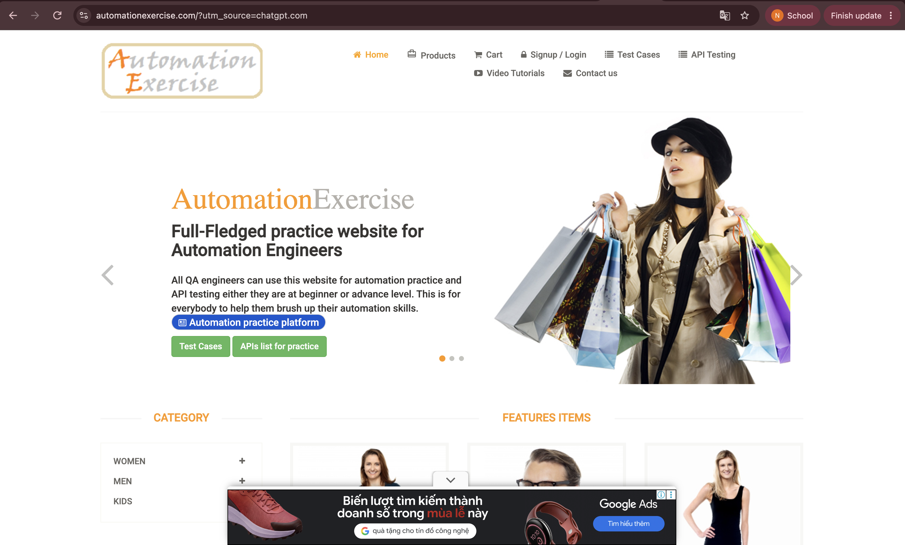

Hình ảnh trang chủ của website được sử dụng làm đối tượng kiểm thử.

### 5.2. Kết quả chạy test bằng pytest

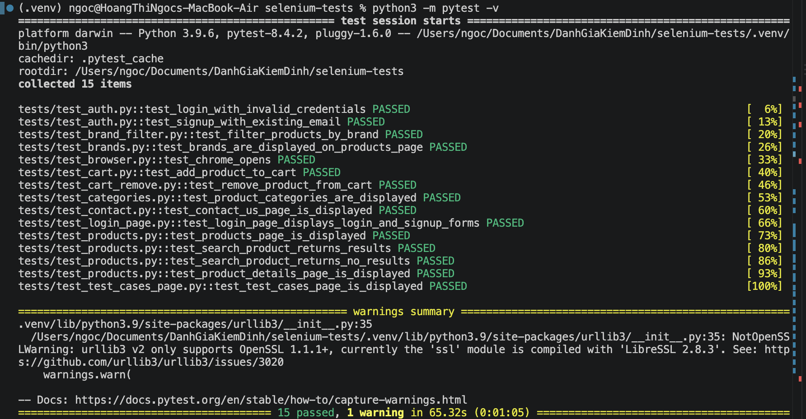

Ảnh terminal ghi nhận kết quả thực tế của lần chạy test. Kết quả tham chiếu của dự án là 15 test thành công, 1 cảnh báo và không có test thất bại.

### 5.3. Trang danh sách sản phẩm

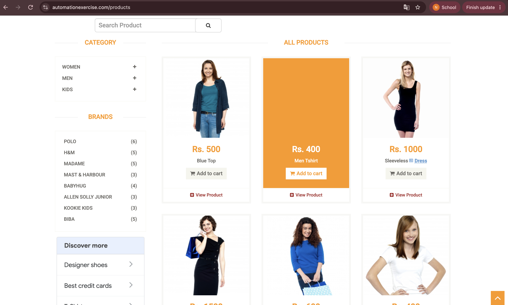

Minh họa trang danh sách sản phẩm được sử dụng trong các test case kiểm thử sản phẩm.

### 5.4. Kết quả tìm kiếm sản phẩm

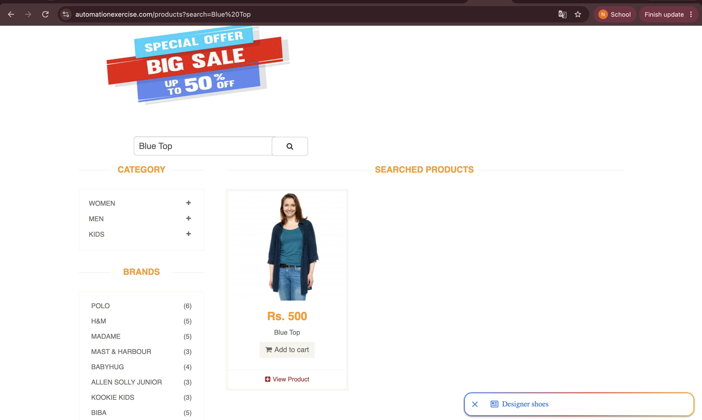

Minh họa chức năng tìm kiếm sản phẩm và phần kết quả được hiển thị sau khi tìm kiếm.

### 5.5. Trang chi tiết sản phẩm

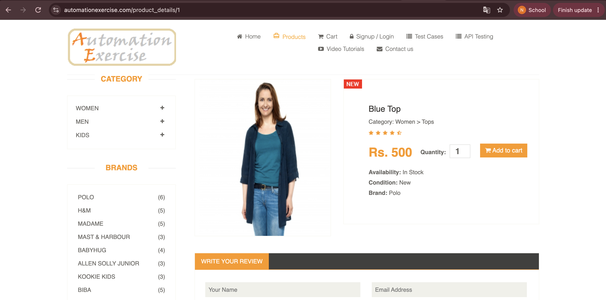

Minh họa giao diện chi tiết của một sản phẩm.

### 5.6. Thêm sản phẩm vào giỏ hàng

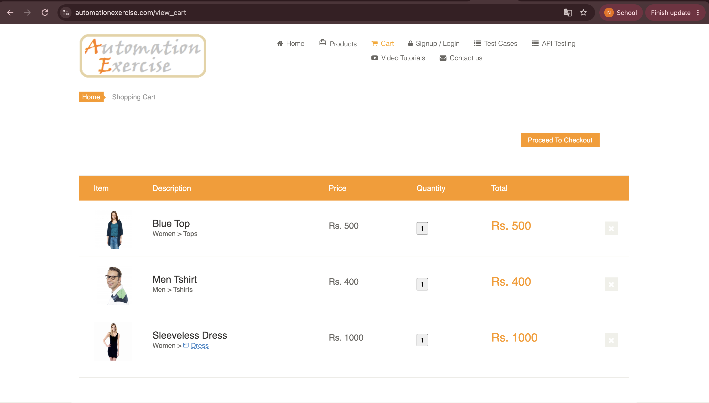

Minh họa trạng thái giỏ hàng sau khi thực hiện thao tác thêm sản phẩm.

### 5.7. Xóa sản phẩm khỏi giỏ hàng

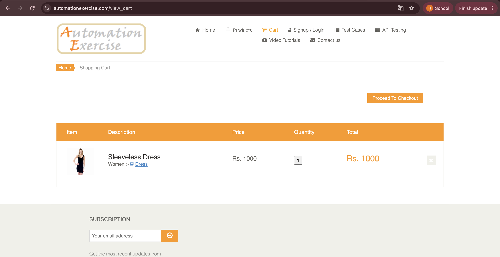

Minh họa trạng thái giỏ hàng sau khi thực hiện thao tác xóa sản phẩm.

### 5.8. Trang Login / Signup

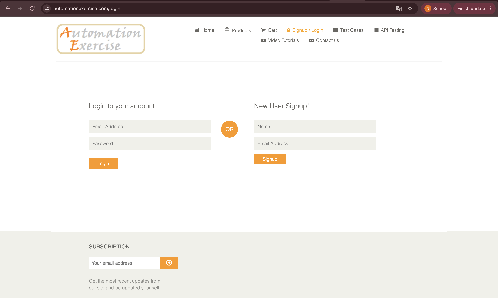

Minh họa giao diện đăng nhập và đăng ký tài khoản.

### 5.9. Kiểm tra thông tin đăng nhập và đăng ký

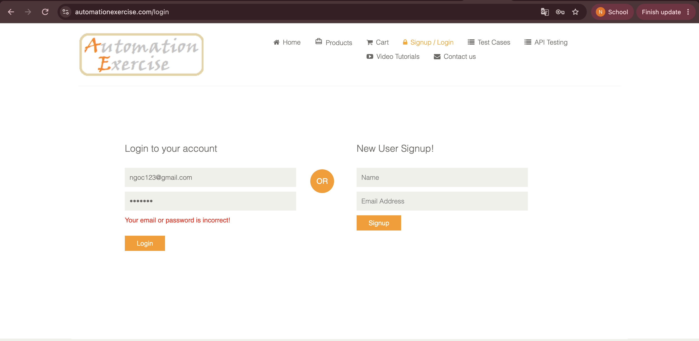

Minh họa thông báo xác thực liên quan đến đăng nhập không hợp lệ hoặc đăng ký bằng email đã tồn tại.

### 5.10. Trang Contact Us

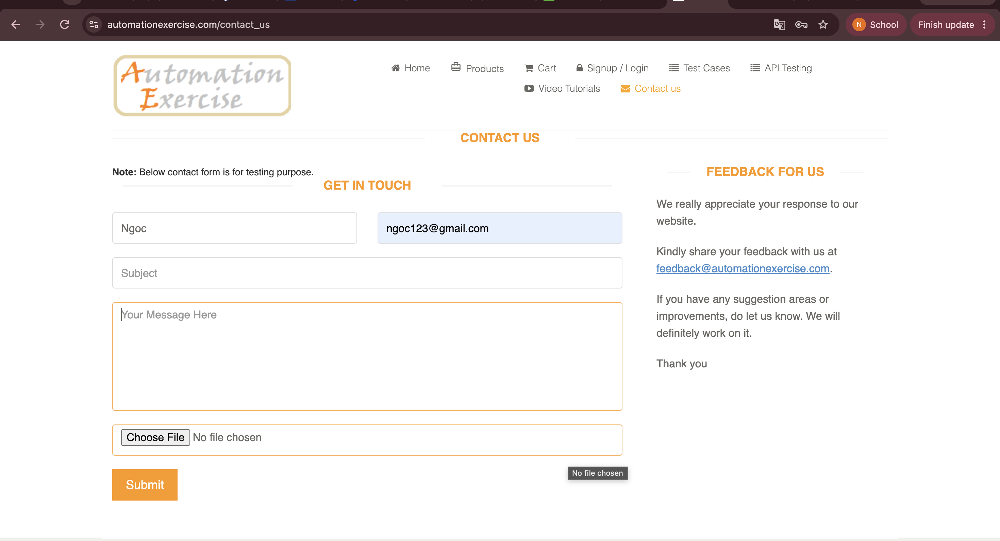

Minh họa trang liên hệ và các trường thông tin của biểu mẫu.

### 5.11. Danh mục sản phẩm và thương hiệu

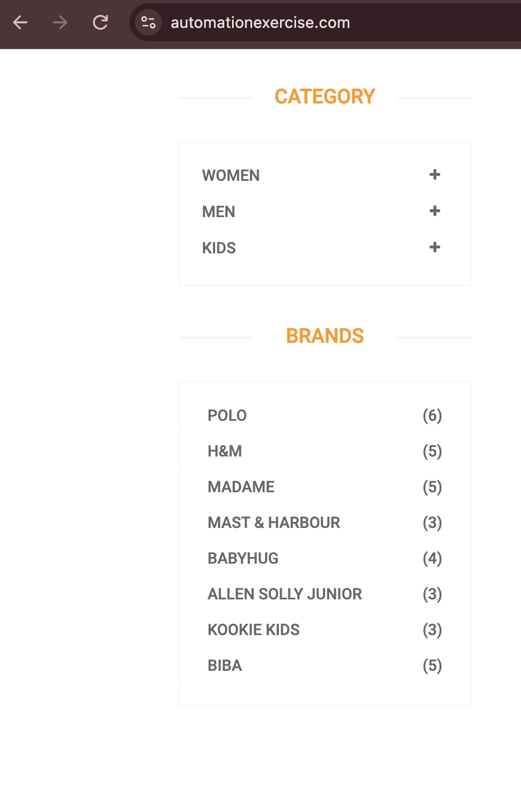

Minh họa khu vực hiển thị danh mục sản phẩm và danh sách thương hiệu trên website.

## 6. Yêu cầu môi trường

Để chạy dự án, cần chuẩn bị:

- Máy tính có cài đặt Python.
- Google Chrome.
- Git.
- Kết nối Internet để truy cập website được kiểm thử và cài đặt các thư viện khi cần.

Dự án đã được thực hiện trên macOS với Python 3.9.6. Các phiên bản thư viện cụ thể được quản lý trong `requirements.txt`.

## 7. Hướng dẫn cài đặt

### 7.1. Lấy mã nguồn

Nếu đã có repository trên máy, mở Terminal và đi đến thư mục dự án:

```bash
cd ~/Documents/DanhGiaKiemDinh/selenium-tests
```

Nếu muốn tải dự án trên một máy khác, sao chép URL repository trên GitHub và chạy:

```bash
git clone <GITHUB_REPOSITORY_URL>
cd selenium-tests
```

Thay `<GITHUB_REPOSITORY_URL>` bằng URL thực tế của repository.

### 7.2. Kiểm tra Python

Chạy lệnh:

```bash
python3 --version
```

Lệnh này hiển thị phiên bản Python đang được sử dụng.

### 7.3. Tạo môi trường ảo

Trong thư mục dự án, chạy:

```bash
python3 -m venv .venv
```

Môi trường ảo giúp tách biệt các thư viện của dự án khỏi những dự án Python khác trên cùng máy tính.

### 7.4. Kích hoạt môi trường ảo trên macOS

```bash
source .venv/bin/activate
```

Sau khi kích hoạt thành công, Terminal thường hiển thị `(.venv)` ở đầu dòng lệnh.

### 7.5. Cài đặt thư viện

Cập nhật pip:

```bash
python -m pip install --upgrade pip
```

Cài đặt các thư viện được khai báo trong dự án:

```bash
pip install -r requirements.txt
```

Sau khi cài đặt, có thể kiểm tra phiên bản pytest và Selenium:

```bash
pytest --version
python -c "import selenium; print(selenium.__version__)"
```

## 8. Hướng dẫn chạy kiểm thử

Đảm bảo đã kích hoạt môi trường ảo trước khi thực hiện các lệnh dưới đây.

### 8.1. Chạy toàn bộ test case

```bash
pytest -v
```

Trong đó:

- `pytest`: khởi chạy bộ kiểm thử.
- `-v`: hiển thị tên từng test case cùng trạng thái thực thi.

Lệnh này giúp kiểm tra toàn bộ test case trong thư mục `tests/`.

### 8.2. Chạy một file test cụ thể

Ví dụ, chạy các test liên quan đến sản phẩm:

```bash
pytest -v tests/test_products.py
```

Chạy test kiểm tra thêm sản phẩm vào giỏ hàng:

```bash
pytest -v tests/test_cart.py
```

Chạy test kiểm tra đăng nhập và đăng ký:

```bash
pytest -v tests/test_auth.py
```

Cách chạy theo file giúp tập trung kiểm tra một nhóm chức năng thay vì thực thi toàn bộ bộ test.

### 8.3. Đọc kết quả pytest

Một số trạng thái thường gặp:

| Trạng thái | Ý nghĩa |
|---|---|
| `PASSED` | Test case đã chạy và các điều kiện kiểm tra đều đạt |
| `FAILED` | Test case không đạt điều kiện kiểm tra |
| `ERROR` | Có lỗi trong quá trình thiết lập hoặc thực thi test |
| `SKIPPED` | Test case bị bỏ qua theo cấu hình hoặc điều kiện chạy |
| `WARNING` | Có cảnh báo từ thư viện hoặc môi trường; cần xem nội dung cụ thể |

Khi chạy toàn bộ test, pytest cũng hiển thị phần tổng kết số lượng test thành công, thất bại, bị bỏ qua và thời gian thực thi.

## 9. Kết quả kiểm thử

Trong lần chạy đã ghi nhận của dự án, bộ test có kết quả:

```text
15 passed, 1 warning in 65.32s
```

Ý nghĩa:

- `15 passed`: 15 test case hoàn thành thành công.
- `1 warning`: có một cảnh báo trong quá trình chạy.
- `65.32s`: thời gian thực thi của lần chạy được ghi nhận.

Cảnh báo đã xuất hiện liên quan đến `urllib3` và phiên bản LibreSSL được sử dụng trong môi trường Python trên macOS. Cảnh báo này không làm cho các test case trong lần chạy đó thất bại.

Kết quả trên phản ánh lần chạy đã ghi nhận, không đảm bảo mọi lần chạy sau đều có kết quả giống hệt nhau. Kết quả thực tế có thể thay đổi tùy thuộc vào trạng thái website, mạng, trình duyệt và môi trường thực thi.

## 10. Quản lý mã nguồn bằng Git

Git được sử dụng để theo dõi các thay đổi trong quá trình phát triển dự án. Mỗi nhóm thay đổi được ghi lại bằng commit để dễ xem lịch sử và xác định nội dung đã cập nhật.

Một số lệnh Git cơ bản:

Kiểm tra trạng thái repository:

```bash
git status
```

Xem lịch sử commit:

```bash
git log --oneline
```

Thêm các thay đổi vào staging area:

```bash
git add .
```

Tạo commit:

```bash
git commit -m "test: describe test changes"
```

Đẩy commit lên GitHub:

```bash
git push origin main
```

Thông điệp commit nên mô tả ngắn gọn và rõ ràng nội dung thay đổi. Ví dụ:

```text
test: verify adding product to cart
```

## 11. Kết luận

Dự án đã áp dụng Selenium WebDriver, Python và pytest để xây dựng bộ kiểm thử giao diện web tự động cho website Automation Exercise.

Thông qua 15 test case, dự án thực hành việc khởi tạo trình duyệt, tương tác với các thành phần trên giao diện, kiểm tra kết quả thao tác và tổ chức test theo từng nhóm chức năng. Việc sử dụng fixture giúp quản lý vòng đời WebDriver, trong khi Git và GitHub hỗ trợ theo dõi và lưu trữ mã nguồn.

Kết quả chạy test đã ghi nhận 15 test case thành công. Đây là cơ sở để đánh giá việc triển khai hiện tại trong phạm vi các chức năng đã được kiểm thử.
